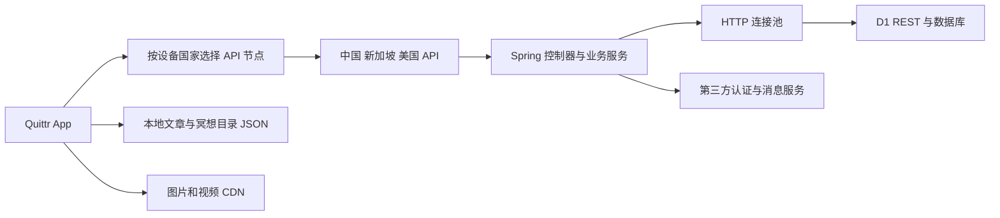

# Quittr 后端接口回归与用户体验优化调研报告

调研时间：2026 年 11 月 2 日至 3 日，北京时间。报告日期：2026 年 11 月 3 日。

## 1 结论与建议顺序

Quittr 后端存在明确的优化空间，但当前最重要的问题并不只是服务器速度：**登录身份可信性、写操作归属、失败结果缓存和写请求重试，会直接影响用户是否能信任操作结果。** 性能方面，个人帖子列表的逐条统计查询、未压缩的内容响应，以及客户端与后端等待预算不一致，都是具体可改的点。

本轮没有修改业务接口、生产配置或数据库，也没有恢复此前在 App 中撤回的图片和视频优化。交付是调研报告、逐接口矩阵、隔离测试及脱敏实测证据。

| 顺序 | 事项 | 证据强度 | 对用户的影响 |
| --- | --- | --- | --- |
| P0 | Google 登录重新验证 ID Token | 真实登录服务逻辑在模拟身份数据下，接受没有 ID Token 的请求 | 登录身份不可信 |
| P0 | 写接口绑定服务端身份及资源归属 | 无身份请求能到达帖子修改、删除服务；代码未见统一应用层鉴权 | 账号和内容控制权风险；生产网关保护情况尚待核实 |
| P1 | 限制写请求重试并设计幂等性 | 本地服务器消费 POST 后断开，客户端将相同 POST 发出两次 | 重复点赞、重复提交或状态不一致的风险 |
| P1 | 禁止缓存失败响应 | 视频接口临时失败后，第二次请求没有重新访问服务 | 用户持续重试仍失败 |
| P1 | 合并个人帖子列表的统计查询 | 10 条帖子产生 10 次点赞统计和 10 次评论统计调用 | 个人主页和帖子列表等待变长 |
| P1 | 校验分页参数并设置上限 | size=100000 到达服务，size=-1 到达 SQL 查询参数 | 超大查询、内存和延迟风险 |
| P1 | 为公开 JSON 内容响应启用压缩 | 三个列表的本地 gzip 结果减少约 66% 字节 | 弱网下传输更轻，且可保留现有响应结构 |
| P2 | 统一业务错误、等待预算和可观测指标 | HTTP 200 可包装业务失败；App 首响应超时预算小于后端单次读取超时 | 用户难以判断是否成功，监控难发现真实失败 |

**全量范围已盘点并执行本地接口冒烟，但不能称为全部接口的真实数据库业务验收。** 每个接口的验证深度见 `endpoint-matrix.csv`，未做的部分没有计为通过。

## 2 范围与基线

实际后端目录为 `cursor-quttr-web`，不是 `cursor-quittr-web`。这个仓库同时承载 Quittr App 和 StoryAI 网站。此次覆盖 `com.example.cursorquitterweb.controller` 下的 Quittr 控制器，以及所关联的关键服务、数据库访问工具和 Flutter 调用；不将 `/api/music-mv/v1/**` 网站业务混入 App 回归。

- 后端代码基线：`d7ad925436f02fe9c297045154737e63c7383ecb`，包含当时工作区原有的 StoryAI 未提交改动；本轮没有修改或提交这些改动。
- App 基线：`5c6770ac194922f3a17e38a977a204d9e35b8e6b`，分支 `main-us`。
- 静态配置：Spring Boot 2.7.18，Java 8；数据库通过 `CloudflareD1Util` 调用远端 D1 REST API；应用使用 Caffeine 缓存。
- 注册到隔离 Spring MVC 的 Quittr 控制器：**49 个**。
- 按“HTTP 方法＋路径”去重：**503 个接口**；按内容协商区分：**504 个路由变体**。`GET /privacy` 的 HTML 和 JSON 是两个合法变体。
- 路由变体方法分布：GET 350，POST 67，PUT 49，DELETE 38。
- App 静态扫描提取了 54 条 API 字符串引用。它们包含路径片段和动态占位符，不能视为完整的运行时调用次数；来源见 `app-api-references.json`。
- 线上三个域名的部署版本没有通过管理端核验。线上结果与本地代码证据分别呈现，不假设线上部署一定等于本地 HEAD。

## 3 回归方法和实际覆盖

用户授权范围：本地隔离测试，线上只读。

| 层次 | 执行量 | 结果及准确含义 |
| --- | --- | --- |
| 全量路由解析 | 504 个断言 | 全部定位到预期控制器方法；不执行数据库业务 |
| 真实控制器隔离请求 | 504 个请求 | 已逐项执行并记录响应；服务依赖用 Mockito 替身，JSON 正文采用空对象，主要覆盖绑定、验证、空结果和异常封装 |
| 关键行为验证 | 13 项 | 全部完成预设断言；其中多项断言是复现现有缺陷，并非通过产品安全验收 |
| 三节点公开 GET | 12 个接口 × 3 个节点 × 3 次 | 108/108 返回 HTTP 200 且业务 success=true |
| 去除环境代理的控制请求 | 3 次 bootstrap | 三个域名均可直连；仅单次控制值，不能据此推断各地区体验 |
| 直连压缩检查 | 3 个内容列表 | 显式请求 gzip 仍无 gzip 响应头；完成本地 gzip 字节数对比 |

本地控制器请求记录：HTTP 200 为 438 次，201 为 1 次，400 为 37 次，404 为 18 次，500 为 10 次。**这些状态来自模拟依赖与最小输入，不能用于计算生产成功率，也不能把 10 次 500 全部判定为产品缺陷。** 502 个请求保留了预期 HandlerMethod；另外两个请求在 `/api/users/init` 和 `/api/logs/level` 的模拟空依赖结果下抛出异常。对应路由在独立的路由解析检查中均通过。

初次路由检查中 `/privacy` 因未填写 Accept 头而选中了 JSON 变体，补齐该路由的内容协商条件后通过；这是测试夹具修正，不是接口缺陷。

隔离构建在临时目录进行，未加载生产 `application.yml`，未启动整个后端，未执行生产 D1、OSS、推送、支付、短信或第三方生成调用。HTTP 重试用例只连接本机随机端口。线上公开响应正文解析后即丢弃，证据只保存状态、耗时、字节数和结构摘要。

### 3.1 尚未完成的业务验收

以下不在本次已通过范围：503 个接口的真实数据库正向 CRUD、跨表事务、真实账号角色矩阵、真实 Apple/Google/微信登录、手机验证、支付、推送送达、RTM 消息送达、真实文件上传、生产并发容量、长时间稳定性和全部用户地域网络体验。

其中写业务需要隔离数据库、第三方服务沙箱及对应夹具。现有旧版 Quittr 用户、帖子、评论等集成测试有整段注释的情况，不能把其他网站模块的测试数量算成 App 的覆盖率。

## 4 与 App 用户路径的关系



| 用户场景 | 当前依赖 | 优化重点 |
| --- | --- | --- |
| 登录、个人资料、挑战记录 | 用户与认证接口 | 身份校验、写入归属、幂等和失败后的结果确认 |
| 社区信息流 | `/api/posts/getAllPosts` | 保留已有单 SQL 聚合；限制分页参数，记录数据库与网络耗时 |
| 个人帖子列表 | `/api/posts/user/{userId}/page` | 优先消除逐条点赞／评论查询 |
| 帖子回复、频道聊天 | 评论、频道和 RTM 接口 | 补齐真实隔离数据测试、消息权限与去重，再评估游标分页 |
| 白噪音、纯音乐、激励视频 | 公开 JSON 列表＋媒体 CDN | JSON 压缩、仅缓存成功结果、保持内容更新失效 |
| 文章列表和详情 | 当前 App 读取本地合并 JSON | 后端文章接口提速不会直接改善当前 App 这条本地路径 |
| 冥想目录和首页冥想入口 | 当前 App 读取本地 JSON，媒体再从 CDN 加载 | 分开测目录、封面、视频首帧；不能用目录 API 耗时替代视频首帧 |

源码依据：App `lib/services/api_service.dart:1571`、`:1610`、`:1809`、`:1840`；个人帖子调用 `:507`；节点选择 `lib/config/api_config.dart`。

## 5 线上公开接口实测

每格为 **三次完整请求的中位数 / 最大值，单位毫秒**。这是同一台电脑的低频样本，不是 P95、P99、服务器执行时间或全球用户基准。每次 curl 单独建连，计入连接与 TLS 等开销；App 的持久连接表现可能不同。

主批次继承了本机 `127.0.0.1:7890` 代理配置。额外用 `--noproxy '*'` 验证 bootstrap，三节点单次分别约 111.5、2500.4、717.9 ms；它们仍不是各地域的本地网络探针。**不能根据下表把新加坡用户统一切换到美国，也不能把慢请求全部归因于数据库。**

| GET 路径 | 中国 | 新加坡 | 美国 |
| --- | ---: | ---: | ---: |
| `/api/bootstrap` | 59.0 / 133.3 | 2548.0 / 2834.8 | 1410.1 / 1559.7 |
| `/api/videos/getAllVideos?page=0&size=10` | 65.8 / 465.5 | 1905.1 / 2377.5 | 1405.0 / 6593.7 |
| `/api/music/page?page=0&size=10` | 496.1 / 806.6 | 2072.7 / 2237.7 | 1296.5 / 7872.1 |
| `/api/quotes/page?page=0&size=10` | 489.8 / 519.9 | 2108.2 / 2130.6 | 1377.5 / 1406.7 |
| `/api/articles/grouped-by-type` | 67.0 / 514.3 | 1750.5 / 1998.3 | 1145.3 / 1520.7 |
| `/api/white-noises` | 80.5 / 84.1 | 2654.8 / 3623.1 | 1271.2 / 1297.3 |
| `/api/pure-musics` | 73.1 / 83.6 | 1930.2 / 2102.7 | 1267.7 / 2393.8 |
| `/api/breathe/getAllBreathe` | 65.9 / 69.3 | 1952.7 / 2799.8 | 1727.1 / 2125.2 |
| `/api/meditate-videos/getAllMeditateVideos?page=0&size=10` | 69.6 / 1777.9 | 2816.1 / 8426.3 | 1082.3 / 2293.9 |
| `/api/video-scenarios/getAllVideoScenarios?page=0&size=10` | 70.9 / 491.6 | 1833.2 / 2189.2 | 1257.0 / 3620.7 |
| `/api/sister-motivation-videos/list` | 78.2 / 78.3 | 2013.6 / 2154.3 | 1523.0 / 1538.4 |
| `/api/posts/getAllPosts?page=0&size=5` | 570.2 / 580.4 | 2040.3 / 2272.1 | 1300.3 / 2690.2 |

可以确认的现象：

1. 中国节点的部分内容接口后续样本明显短于第一次，例如视频列表由 465.5 ms 到 65.8/64.1 ms；这与代码中的缓存路径一致，但未拿到服务器缓存命中指标，不能将首个样本直接命名为冷缓存。
2. 中国社区信息流样本为 580.4、569.1、570.2 ms；音乐分页为 496.1、490.4、806.6 ms。它们值得进一步拆分 SQL、连接池等待、网络与序列化耗时。
3. 海外路径存在长尾样本，美国音乐分页最大 7872.1 ms，新加坡冥想目录最大 8426.3 ms。需要各地区本地探针和服务端 requestId 对齐才能定位原因。
4. 这 108 次请求均成功，只说明当时所选公开接口在低频访问下可用。没有进行压测、故障注入或生产写入。

## 6 已复现的问题和具体优化方案

### 6.1 P0 Google 登录没有验证 ID Token

**证据。** `GoogleAuthServiceImpl.java:49–68` 的 login 直接根据客户端传来的 google_user_id 查找身份，并明确跳过 Token 验证。隔离用例用完全合成的身份和用户数据，不提供 id_token，仍能进入已有用户登录、保存并返回结果。服务内虽有 verifyIdToken 方法，当前 login 路径没有调用它。Apple 登录路径存在验证步骤，不应把此结论泛化到所有第三方登录。

**用户影响。** 用户身份是否真实不能只依赖客户端声明。这个问题应先于普通性能微调处理。

**建议。** 服务端验证签名、aud、iss、exp，以验证后的 sub 查找账号；缓存公钥减少重复网络等待，公钥轮换或验证失败应明确失败。登录成功建立服务端可验证的会话。不要以跳过认证换取登录速度。

**回归要求。** 缺失／过期／错误签名／错误受众的 Token 拒绝且不写用户表；合法 Token 可登录；公钥轮换、时钟偏差、上游暂时不可用、同一身份并发注册均需覆盖。当前 App 会话协议也要共同评估，不能只改后端就宣称兼容所有旧客户端。

依据：[Google 后端身份验证官方说明](https://developers.google.com/identity/sign-in/web/backend-auth)。

### 6.2 P0 写接口缺少应用层身份与资源归属约束

**证据。** 对真实 PostController 的本地 MockMvc 请求不带认证身份，修改与删除仍调用相应 PostService。`PostServiceImpl.java:108` 的删除 SQL 只按 post_id 更新，没有调用者身份条件。扫描仓库未找到适用于 Quittr 控制器的统一 SecurityFilterChain、权限注解或鉴权拦截器。网站模块的独立行为不能替代 App 权限体系。

**边界。** 测试没有对生产接口执行越权写入；生产入口是否有额外网关授权未知。因此结论是“应用层约束缺口已复现”，不是“已经证实线上任意用户数据被篡改”。

**建议。** 从验证后的会话派生 userId，写操作同时验证资源 owner；公共内容读取与管理写入分离，诊断／同步／日志配置接口使用管理权限。CORS 不能替代身份和归属检查。

**回归要求。** 匿名拒绝、账号 A 不得改账号 B 的资源、合法 owner 成功、管理员按角色授权；失败请求不得产生副作用。需要前后端协同和版本迁移，不属于可直接无风险上线的小补丁。

源码：`controller/PostController.java:70`、`:83`，`service/impl/PostServiceImpl.java:89`、`:108`，`config/WebConfig.java`。

### 6.3 P1 写请求可能被自动重放

**证据。** `WebConfig.java:82–86` 的自定义重试处理只判断 executionCount <= 1，没有根据请求或业务幂等性判断。本地 HTTP 服务完整接收第一次 POST 后断开连接，第二次接收到相同 POST，测试确认 attempts=2。`CloudflareD1Util.java:74` 使用这个 RestTemplate，通过 POST 发送 SQL；其中既有读取也有写入。

**用户影响。** 网络断开不代表数据库没执行。`like_count = like_count + 1` 这类操作重放，可能增加两次；其他写入也可能产生重复结果或不确定状态。此次没有让生产数据库实际重复执行。

**建议。** 数据库写入客户端默认不自动重试不确定结果；确需重试的写入先设计幂等键、唯一约束及结果查询。不能仅按 HTTP GET/POST 粗分 D1 的业务语义，因为 SQL 读取同样走 POST。

**回归要求。** 覆盖请求未到达、请求已到达但响应丢失、服务端成功后客户端超时、相同幂等键重复提交四种情况，确认只产生一次业务效果。

依据：[Apache HttpClient 重试机制](https://hc.apache.org/httpcomponents-client-4.5.x/current/tutorial/html/fundamentals.html)。

### 6.4 P1 视频接口的失败结果会进入缓存

**证据。** `VideoController.java:154` 使用 Cacheable，异常在控制器内部转换成 HTTP 500 ResponseEntity，而不是向缓存拦截器抛出。隔离测试第一轮让服务失败，第二轮调用同参数接口，结果仍为 500，服务实际只被调用一次。测试使用真实 Spring 缓存拦截器。

仓库默认 Caffeine 配置为 `maximumSize=1000,expireAfterWrite=12h`。按这个默认值，未被失效、重启等机制清除的失败对象可能留存 12 小时；线上生效 TTL 没有通过管理端核验。

**建议。** 只缓存正常业务数据；失败、权限错误和异常响应不写缓存。保留现有成功结果缓存及写操作失效逻辑。对其他 Cacheable 控制器逐项检查，不要统一关闭所有缓存。

**回归要求。** 第一次故障、第二次服务恢复时必须重新回源成功；成功结果仍命中缓存；内容更新后可立即刷新。这个修复比单纯缩短转圈时间更直接。

### 6.5 P1 个人帖子列表存在逐条统计查询

**证据。** App 使用 `/api/posts/user/{userId}/page`。控制器调用 findByUserIdWithUpvotes，服务逐条 convertToPostWithUpvotesDto；每条分别调用点赞统计和评论统计。10 条合成帖子验证得到 10＋10 次统计服务调用。结合对应服务各一次 D1 查询的代码，连同列表查询，这是约 1＋2N 的数据库访问路径。

**建议。** 优先复用现有 getLikeCountsBatch 和 countByPostIdsBatch，对当前页 postId 批量统计，或使用经验证的 JOIN 聚合，一页数据库请求数控制在固定少量，保持现有 DTO 和排序不变。主信息流 getAllPostsWithUpvotesAndCount 已有单 SQL JOIN＋窗口计数，不需要重复重写成另一套“优化”。

**回归要求。** 0/1/10/50 条记录下，统计值与原结果一致；删除评论不计数；无点赞帖显示零；一页查询次数不随条数线性增加。先将这一条路径的请求次数目标设为不超过 3 次，再测实际耗时，而不是直接承诺提速百分比。

源码：`controller/PostController.java:152–159`，`service/impl/PostServiceImpl.java:129`、`:444`。

### 6.6 P1 分页尺寸没有统一边界

**证据。** 本地请求 size=100000 可以到达帖子查询服务；size=-1 可以到达 SQL 参数。代码直接计算 offset=page*size。没有在线执行这类大查询。负数 LIMIT 在 SQLite 语义中可能取消数量上限，应在进入 SQL 前拒绝，不应依赖数据库兜底。

**建议。** 统一 page>=0、size 的合理上限、排序字段白名单；针对需要全部静态内容的接口保留清晰的专用协议。旧客户端的 size=1000 调用要先盘点，不能突然全局截断并造成内容缺失。

**回归要求。** 负数、零、极大值、整数溢出、未知排序字段、最后一页及空列表；先验证 App 的完整内容获取方式，再收紧线上约束。

### 6.7 P1 公开 JSON 列表可以先做响应压缩

三个接口在中国节点直连、显式声明 Accept-Encoding: gzip 时，仍返回未压缩正文。对本次原始响应做 gzip level 6，本地结果如下：

| 内容列表 | 原始字节 | 本地 gzip 字节 | 字节减少 |
| --- | ---: | ---: | ---: |
| 白噪音，13 项 | 44,226 | 14,838 | 66.4% |
| 纯音乐，7 项 | 24,673 | 8,497 | 65.6% |
| 激励视频，19 项 | 31,793 | 10,471 | 67.1% |

**这不是已上线的收益，也不等于加载时间减少相同比例。** 此项只涉及 API JSON，和此前用户要求撤回的 App 图片、视频处理是两回事。

**建议。** 先为适合的公开 JSON 响应配置 gzip，核对代理层、Vary 和客户端解压；保持字段、语言和排序不变。确认收益后，再单独设计只返回目标语言或列表摘要字段的版本化接口，避免直接删字段破坏旧 App。

**回归要求。** 压缩与未压缩响应解码后数据一致；中文及其他语言正常；Android/iOS 均可解析；缓存协商正确；监控 CPU 与首字节耗时。无需重新编码图片或视频。

### 6.8 P2 超时预算和写入结果需要一致

`WebConfig.java:63–65` 为上游连接设置 8 秒、读取 25 秒、连接池获取 3 秒，并允许重试。App 的 BoundedHttpClient 首响应等待和响应体停滞上限各为 20 秒；它不是所有请求的统一端到端 deadline。

**风险。** 用户侧已经看到超时，服务端仍可能继续执行。用户再点一次，若没有幂等约束，容易造成“到底成功没有”的体验问题。

**建议。** 为用户动作定义完整 deadline，分别预算队列、连接、数据库和响应；耗时任务改用任务状态查询；写请求以操作标识确认结果。日志关联 requestId，避免客户端和服务器各自超时但无法串起同一次动作。

### 6.9 P2 业务错误和监控成功口径不一致

本地验证中，不存在的帖子、模拟数据库异常都可返回 HTTP 200、success=false；异常信息会进入用户响应。ControllerPerformanceAspect 只在 Java 异常向外抛出时记录异常，控制器内部捕获后返回失败对象的情况可能仍记录“成功”。

**建议。** 先增加稳定错误码、requestId 和业务成功指标，并明确用户可见文案；逐步协调 App 对错误响应的处理，再统一状态码。不要把底层 SQL、服务商错误正文直接返回用户。监控同时记录 HTTP 状态和业务错误码。

**回归要求。** 离线、超时、找不到记录、无权限、重复请求和服务故障能够区别展示；重试按钮只针对可重试情况；监控不会把业务失败全部计为成功。

### 6.10 P2 区域路由和数据库瓶颈需要更多可观测证据

本次跨节点抽样包含代理、DNS、TLS、区域网络和服务器处理。当前 ControllerPerformanceAspect 记录总方法耗时，但没有在本轮获取到与每个请求关联的 D1 次数、连接池等待和缓存命中数据。

**建议。** 加入 requestId、业务结果、缓存命中、D1 请求次数及耗时、连接池排队、序列化大小；在主要用户地域部署只读探针。然后再决定节点选择、SQL 索引、分页或数据库访问架构改造。

索引是否合适应以真实数据分布、EXPLAIN QUERY PLAN 和 D1 查询指标判断。本轮没有检查生产数据库实际索引，因此没有将“缺少某条索引”列为已证实缺陷。

依据：[Cloudflare D1 索引说明](https://developers.cloudflare.com/d1/best-practices/use-indexes/)、[D1 慢查询观测](https://developers.cloudflare.com/d1/observability/find-expensive-queries/)。

## 7 建议实施批次与验收

| 批次 | 内容 | 实施边界 | 验收重点 |
| --- | --- | --- | --- |
| 安全与一致性专项 | Google Token、服务端身份／归属、写请求幂等与重试 | 前后端协同；先明确旧版本迁移和测试账号矩阵 | 不可信身份不能写；重复请求不重复生效；合法用户不被误拒 |
| 首批性能修复 | 不缓存失败、公开 JSON 压缩、个人帖子批量统计 | 保持响应字段与内容数量；每项独立提交和灰度 | 故障恢复后立即成功；解码后数据相同；统计值相同且查询数下降 |
| 参数与错误契约 | 分页边界、稳定错误码、deadline | 先盘点旧 App 大页请求；不直接截断内容 | 边界输入可控；重试不会造成重复写；App 能解释失败 |
| 后续结构优化 | 地域探针、SQL 计划、游标分页、数据库访问链路 | 获取真实基线后再决定，避免无依据换架构 | 主要地区及真实数据规模下的延迟、错误率和资源消耗均改善 |

每项上线前，应保存同环境前后结果；上线后同时检查性能、业务成功率和内容完整性。首批不需要更换播放器、重编码媒体或重写整个状态管理。

本次已确认的正向基础应保留：主信息流聚合查询、现有内容缓存和写入失效、中文内容独立缓存键、Apple 登录验证路径、App 侧不自动重试写请求的有界 HTTP 客户端。

## 8 交付文件与复跑

- `endpoint-matrix.csv`：504 行路由变体，包含源码定位、本地结果、线上只读覆盖和未验证边界。
- `routes.json`：Spring MVC 实际注册路由元数据。
- `endpoint-contracts.json`：504 次隔离控制器请求记录；状态码来自模拟环境。
- `test-summary.json`：三组隔离检查的脱敏统计和用例名。
- `public-probes.jsonl`、`latency-summary.json`：108 次公开 GET 明细及汇总。
- `direct-network-check.json`、`compression-evidence.json`：直连与压缩控制证据。
- `app-api-references.json`：54 条 App 静态 API 字符串引用。
- `local-tests/`、`run_local_audit.py`：可复跑的全量路由检查、控制器冒烟和 13 项行为验证。
- `probe_public.py`：仅执行固定白名单中的公开 GET，不保存响应正文；重新运行会产生新的线上只读流量。

从后端仓库运行：

```sh
python3 docs/qa/quittr-app-backend-audit-2026-11-03/run_local_audit.py --output /tmp/quittr-api-audit-new-run
```

输出目录必须不存在或为空。需要 Java 8 和 Maven；首次构建可能下载 Maven 依赖。脚本使用独立编译目录，不覆盖当前后端的 target，也不加载生产配置。三个测试组的 JUnit 数量不能相加后宣传为同等数量的业务验收场景。

重新执行公开只读抽样：

```sh
python3 docs/qa/quittr-app-backend-audit-2026-11-03/probe_public.py --output /tmp/quittr-public-probe-new-run
```

复测时应记录是否使用代理、网络所在地、时间和部署版本；不要直接将不同时点、不同代理的数字作为严格 A/B 结果。

## 9 控制器覆盖清单

下表为路由变体数，含管理／诊断接口，不代表这些接口全部由当前 App 直接调用。逐项路径在 CSV 中。

| 控制器 | 路由变体 |
| --- | ---: |
| AppBlockScheduleController | 6 |
| AppleAppSiteAssociationController | 1 |
| AppleAuthController | 3 |
| ArticleCnController | 20 |
| ArticleController | 20 |
| ArticleSectionCnController | 9 |
| ArticleSectionController | 9 |
| BookController | 18 |
| BootstrapController | 1 |
| BreatheController | 17 |
| ChangeReasonController | 8 |
| ChannelController | 8 |
| CommentController | 23 |
| CommunityCnToGlSyncController | 1 |
| FeedbackController | 12 |
| GlCommentController | 23 |
| GlCommentReportController | 5 |
| GlPostController | 14 |
| GlPostLikeController | 16 |
| GlPostReportController | 5 |
| GoogleAuthController | 3 |
| HelloController | 2 |
| HomeController | 1 |
| LogController | 3 |
| MeditateVideoCnController | 11 |
| MeditateVideoController | 11 |
| MusicCnController | 26 |
| MusicController | 26 |
| PostController | 14 |
| PostLikeController | 16 |
| PostReportController | 15 |
| PrivacyController | 2 |
| PureMusicController | 6 |
| PushController | 2 |
| QuoteController | 15 |
| RecoverJourneyController | 9 |
| RtmController | 2 |
| SisterMotivationVideoController | 8 |
| SslController | 2 |
| SupportController | 1 |
| UserController | 31 |
| UserIdentityController | 7 |
| UserReportController | 15 |
| VideoCnController | 11 |
| VideoController | 11 |
| VideoScenarioCnController | 14 |
| VideoScenarioController | 14 |
| WechatController | 2 |
| WhiteNoiseController | 5 |

## 10 当前变更与边界

本轮只新增此目录的报告、证据与复跑工具。没有修改后端业务代码、部署配置、线上缓存、数据库索引或生产数据。原有歌词对齐、全局特效、歌曲导入等未提交改动均保留。

按仓库 AGENTS.md 的要求，完成检查后仅对这份调研材料创建本地中文提交；不自动推送或部署。正式修复需要按第 7 节分别实施和验收，不能把本报告当作所有优化已经落地或所有业务已经无问题的证明。
